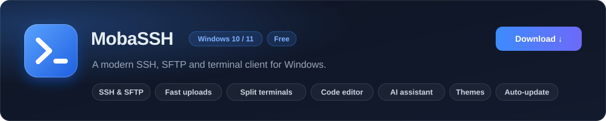

<a href="https://github.com/sisuus63-cmyk/mobassh-releases/releases/latest">
  <picture>
    <source media="(prefers-color-scheme: dark)" srcset="assets/mobassh-dark.svg">
    <source media="(prefers-color-scheme: light)" srcset="assets/mobassh-light.svg">
    
  </picture>
</a>

  
  

## Features

- **SSH and local terminals** with tabs, a split view for up to 9 terminals and GPU rendering
- **SFTP file browser** with drag-and-drop uploads that you can cancel at any time, and it follows your terminal folder
- **Built-in code editor**: open a file on the server, press <kbd>Ctrl</kbd>+<kbd>S</kbd> and it is saved back
- **AI assistant** for Gemini, OpenAI, Anthropic, OpenRouter and Codex. It asks before running a command (by default)
- **Studio**: themes, colors, wallpapers and effects
- **Your secrets stay safe**: saved passwords and API keys are encrypted with Windows (DPAPI)
- **Automatic updates**: new versions show up right inside the app

## Install

1. Download **`MobaSSH-Setup-x.y.z.exe`** from the [latest release](https://github.com/sisuus63-cmyk/mobassh-releases/releases/latest).
2. Run it and pick where to install.

> [!NOTE]
> The installer is not code-signed yet, so Windows may show **"Windows protected your PC"**.
> Click **More info** and then **Run anyway**.

## Updates

MobaSSH checks for a new version when it starts and every few hours after that.
When one is out you will see a card with what changed. Click **Update now**, or **Later** and it installs the next time you close the app.
You can also check by hand from **Help → Check for updates**.

## Found a bug?

[Open an issue](https://github.com/sisuus63-cmyk/mobassh-releases/issues/new) and tell what happened. A screenshot helps a lot.
